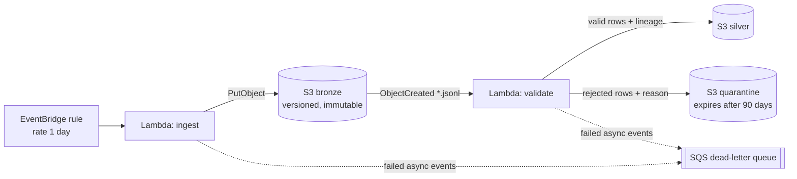

# infra/terraform

The AWS ingestion design for TransitIQ, defined in Terraform and deployed to **LocalStack** (an AWS emulator in Docker). **Nothing here runs on real AWS.**

## What it creates (27 resources)



| File | Contents |
|---|---|
| `versions.tf` | Terraform and provider versions (state is local, see D-005) |
| `providers.tf` | AWS provider pointed at LocalStack with fake credentials |
| `s3.tf` | bronze / silver / quarantine buckets, encryption, public-access block, versioning, lifecycle, S3 → Lambda notification |
| `sqs.tf` | Dead-letter queue |
| `iam.tf` | One least-privilege role per Lambda (no wildcard actions, no `*` resources) |
| `lambda.tf` | Lambda packaging, functions, log groups, retry config, S3 invoke permission |
| `eventbridge.tf` | Schedule rule and target for the ingest Lambda |
| `outputs.tf` | Names used by `scripts/e2e_localstack.py` |

Lambda source code lives in `pipelines/lambdas/`.

## Deploy (from the repo root)

```powershell
docker compose up -d --wait localstack
terraform -chdir=infra/terraform init
terraform -chdir=infra/terraform apply
python scripts\e2e_localstack.py
terraform -chdir=infra/terraform destroy
```

## Honest limitations

- LocalStack's free plan does not enforce IAM. The e2e script checks the deployed policies statically instead (D-007).
- State is a local file, fine for a single developer on an emulator; real AWS would use a remote S3 backend with locking.
